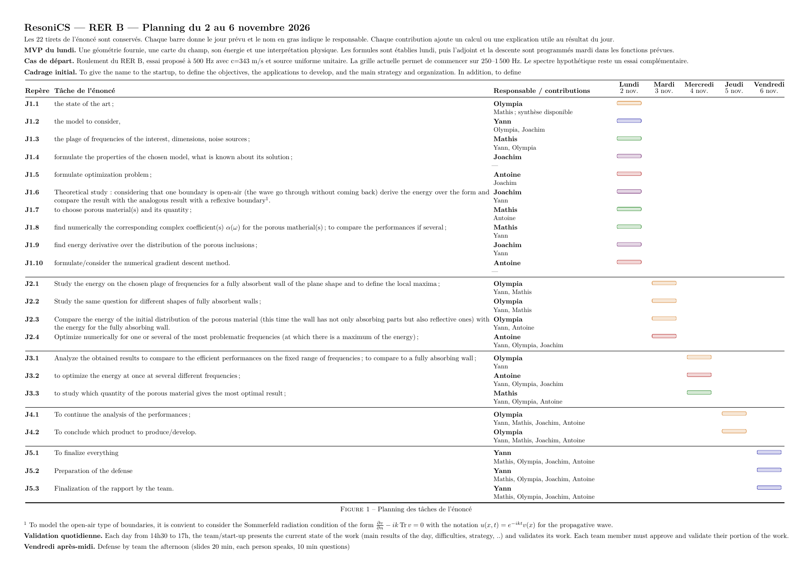

# ResoniCS — Planning d’un MVP étudiant

Chaque contribution ajoute un petit résultat que les cinq membres peuvent expliquer. On reprend les fichiers de `support/`, puis on complète seulement ce qui manque pour la tâche du jour. Les 22 titres de l’[énoncé](../context/Sujet-EI-EXT-2026.md) et leur ordre sont conservés.

## Premier résultat lundi

Le groupe montre un domaine, une source, une carte du champ et une valeur d’énergie. Il explique les paramètres et les conditions aux limites. Les formules de dérivée et de descente demandées lundi sont établies sur papier, puis programmées mardi.

| Membre | Contribution du premier jour |
|---|---|
| Yann | Lancer un cas du programme fourni et expliquer où le son entre et où se trouve le matériau |
| Mathis | Réutiliser l’état de l’art, choisir la bande et calculer le coefficient d’un matériau documenté |
| Olympia | Décrire la géométrie et lire la première carte du champ |
| Joachim | Calculer l’énergie et expliquer les propriétés du modèle, la paroi ouverte et la dérivée |
| Antoine | Poser le problème à quantité fixée et expliquer une étape de descente avec un exemple |

Pour le fichier commun, Joachim complète le calcul d’énergie, puis Yann ajoute son affichage. Chaque personne repart de la dernière version transmise.

## Un cas simple pour commencer

- **Application :** bruit de roulement du RER B. La bande 250–2 000 Hz vient de [SOTA.md](../SOTA.md) et reste indicative.
- **Premier essai proposé :** 500 Hz et c=343 m/s, valeur déjà utilisée pour les courbes fréquentielles. On passe au solveur le nombre d’onde k=2*pi*f/c.
- **Grille :** N=50, M=100 et h=0,02 dans le support. On conserve le générateur, avec `level=1` pour le contour irrégulier et `level=0` pour la référence plane.
- **Source de comparaison :** valeur unitaire uniforme sur le bord supérieur, avec la même phase en tout point.
- **Matériau :** un seul pour commencer. Le cas ISOREL du §3.2.4 du polycopié fournit des données pour calculer un coefficient. Mathis vérifie ces données avant de les utiliser.

À chaque fréquence, la longueur d’onde doit contenir au moins dix points de grille. Avec h=0,02 et c=343 m/s, une première étude 250–1 500 Hz respecte cette règle. Étudier jusqu’à 2 000 Hz demandera un pas plus petit. On annonce la bande effectivement calculée.

`Alpha=10-10j` est encore le coefficient d’exemple du programme. Un résultat obtenu avec cette valeur montre le fonctionnement du calcul. Le choix physique du matériau demandera son coefficient documenté et une convention de signe cohérente avec le solveur.

## Quel rôle donner au spectre RER B ?

Une source uniforme permet de comparer simplement les panneaux. Les trois gaussiennes de `source_rer_b` représentent un **spectre hypothétique**, dont les centres, largeurs et amplitudes ont été choisis pour l’illustration.

À une fréquence fixée, lorsque seule la source supérieure excite le domaine, la linéarité donne

\[
u_G=G(f)u_1,\qquad J_G=|G(f)|^2J_1
\]

Le facteur est commun à tous les panneaux. Pour G non nul, il conserve donc leur classement à cette fréquence. Le coefficient du matériau reste le même.

Sur plusieurs fréquences, les facteurs diffèrent. Ils donnent davantage de poids à certaines fréquences et peuvent ainsi changer la géométrie ou la répartition retenue. Pour le MVP, on construit d’abord les courbes avec la source unitaire. Si le temps le permet, on multiplie ensuite ces énergies par les valeurs de |G(f)|² pour voir l’effet du spectre choisi. Cette étape utilise les résultats déjà obtenus.

Le programme actuel trace déjà un cas pondéré entre **100 et 1 500 Hz, par pas de 50 Hz**, avec c=343 m/s. Comme G est déjà appliqué à la source de ce calcul, ses énergies contiennent déjà ce facteur. La note [sur la source](../context/ResoniCS_modelisation_source_RER_B.md) décrit les hypothèses, mais les références à une ancienne bande et à une autre convention de grille sont à distinguer des réglages actuels du support.

## Construction progressive du résultat

| Jour | Résultat que le groupe sait expliquer |
|---|---|
| Lundi | Un premier champ, son énergie, les choix physiques et les formules demandées |
| Mardi | Les courbes des murs entièrement recouverts, puis une première répartition améliorée à une fréquence |
| Mercredi | Une répartition commune à plusieurs fréquences et l’effet de la quantité de matériau |
| Jeudi | Un choix de panneau justifié par les courbes et une vérification ciblée du résultat |
| Vendredi | Un rapport cohérent et un exposé de vingt minutes où chacun explique sa contribution |

L’optimisation de la répartition du matériau fait partie du sujet. On la programme dans la fonction prévue, avec une première étape, puis une boucle. Les tableaux et les tracés restent simples. Chaque fiche précise ce qu’on calcule, ce qu’on regarde et ce qu’on peut en conclure physiquement.

Les références entièrement recouvertes peuvent utiliser des quantités différentes selon la longueur du mur, ce qu’on indique. Pour comparer équitablement des répartitions optimisées, on fixe une même quantité physique. La fraction `V_obj` de points Robin du support permet de commencer sur une forme donnée.

## Fiches par membre et par jour

| Membre | Lundi | Mardi | Mercredi | Jeudi | Vendredi |
|---|---|---|---|---|---|
| Yann | [Fiche](Yann/01_lundi.md) | [Fiche](Yann/02_mardi.md) | [Fiche](Yann/03_mercredi.md) | [Fiche](Yann/04_jeudi.md) | [Fiche](Yann/05_vendredi.md) |
| Mathis | [Fiche](Mathis/01_lundi.md) | [Fiche](Mathis/02_mardi.md) | [Fiche](Mathis/03_mercredi.md) | [Fiche](Mathis/04_jeudi.md) | [Fiche](Mathis/05_vendredi.md) |
| Olympia | [Fiche](Olympia/01_lundi.md) | [Fiche](Olympia/02_mardi.md) | [Fiche](Olympia/03_mercredi.md) | [Fiche](Olympia/04_jeudi.md) | [Fiche](Olympia/05_vendredi.md) |
| Joachim | [Fiche](Joachim/01_lundi.md) | [Fiche](Joachim/02_mardi.md) | [Fiche](Joachim/03_mercredi.md) | [Fiche](Joachim/04_jeudi.md) | [Fiche](Joachim/05_vendredi.md) |
| Antoine | [Fiche](Antoine/01_lundi.md) | [Fiche](Antoine/02_mardi.md) | [Fiche](Antoine/03_mercredi.md) | [Fiche](Antoine/04_jeudi.md) | [Fiche](Antoine/05_vendredi.md) |

Une tâche de code concerne un seul fichier existant. Les deux blocs `Do not modify this cell` du programme principal restent inchangés, ainsi que les fonctions fournies. Les ajouts se font dans les fonctions étudiantes et les blocs autorisés. Chaque personne vérifie sa modification avant de transmettre le fichier.

## Gantt et documents utiles

[](gantt.pdf)

Le [Gantt](gantt.pdf), le [CSV](build/repartition.csv) et le [JSON](repartition.json) reprennent une tâche par tiret du sujet. Le [guide de lecture](lecture_et_sources.md) indique les passages utiles du cours. Le point quotidien est prévu dans la fenêtre de 14h30 à 17h.

Les sources TeX, PNG et CSV restent dans `build/`. Pour compiler le Gantt depuis ce dossier :

```sh
latexmk -pdf -interaction=nonstopmode -halt-on-error gantt.tex
cp gantt.pdf ../gantt.pdf
```
