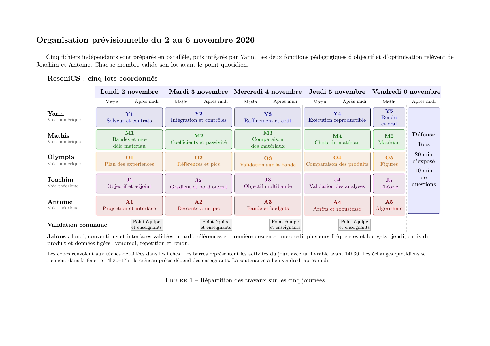

# ResoniCS — Organisation de la semaine d'intégration

Le planning proposé couvre le **lundi 2 au vendredi 6 novembre 2026**. Il suit les cinq journées de l'énoncé, avec un résultat présentable avant les validations quotidiennes dans la fenêtre **14h30–17h**. La soutenance du vendredi après-midi dure **20 minutes**, puis **10 minutes de questions** ; chacun des cinq membres intervient.

[](gantt.pdf)

- [Gantt en PDF](gantt.pdf) et [source LaTeX](gantt.tex).
- [Cahier détaillé des tâches en PDF](cahier_des_taches.pdf) et [source LaTeX](cahier_des_taches.tex).
- [Contrat commun des fonctions](contrat_commun.md).
- [Planning éditable en CSV](repartition.csv) et [JSON](repartition.json).

## Répartition des fichiers

| Membre | Voie | Fichier à produire | Responsabilité principale |
|---|---|---|---|
| [Yann](fiches/Yann.md) | Numérique | `resonics.py` | Adapter et vérifier le solveur fourni, intégrer les lots et coordonner les livrables |
| [Mathis](fiches/Mathis.md) | Numérique | `materiaux.py` | Fixer les unités, documenter les bandes route/rail et fournir la loi complexe du matériau |
| [Olympia](fiches/Olympia.md) | Numérique | `campagnes.py` | Organiser les campagnes, trouver les pics et comparer les formes et les produits |
| [Joachim](fiches/Joachim.md) | Théorique | `objectif.py` | Écrire `your_compute_objective_function`, l'adjoint, le gradient et l'analyse du bord ouvert |
| [Antoine](fiches/Antoine.md) | Théorique | `optimisation.py` | Écrire la projection à quantité fixée et `your_optimization_procedure` |

Chaque fiche contient son contexte, les signatures utiles, les entrées et sorties, la méthode pas à pas, les vérifications et les jalons de la semaine. Elle peut être utilisée seule pour produire le fichier correspondant. Les exemples de contrôle sont écrits dans ce même fichier. Les fonctions qui ne sont pas encore intégrées sont reçues comme arguments et remplacées, dans les seuls contrôles, par de petits exemples synthétiques.

Les codes du Gantt associent une personne et une journée : **Y1–Y5**, **M1–M5**, **O1–O5**, **J1–J5** et **A1–A5** correspondent respectivement au lundi, mardi, mercredi, jeudi et vendredi. Les dates et heures du CSV sont des créneaux prévisionnels de production, avec remise de l'état du lot avant 14h30 ; elles n'imposent pas la durée d'une présentation intermédiaire.

## Dépendances et jalons

| Échéance | Résultat attendu | Dépendance à lever |
|---|---|---|
| Lundi, cadrage | Bandes, dimensions, source, budget et conventions écrits ; interfaces figées ; petits contrôles prêts | Données permettant de calculer une impédance complexe réelle à obtenir ou modèle documenté à choisir |
| Mardi, avant validation | Courbes du mur plan et des profils entièrement recouverts ; pics repérés ; gradient vérifié ; première descente | Loi de matériau validée, solveur et gradient cohérents |
| Mercredi, avant validation | Une distribution commune optimisée sur plusieurs fréquences ; comparaison de plusieurs budgets ; validation sur toute la bande | Projection pondérée et coûts fréquentiels fiables |
| Jeudi, avant validation | Comparaisons après raffinement et plusieurs initialisations ; produit retenu ; données et figures figées | Résultats reproductibles et classement robuste des candidats |
| Vendredi matin | Exécution et documents vérifiés ; répétition à cinq ; archive finale | Validation de chaque lot par son responsable |

Le développement peut avancer en parallèle dès lundi grâce aux contrats et aux contrôles autonomes. Les résultats obtenus avec un coefficient synthétique ne sont pas utilisés pour annoncer une performance de matériau réel.

## Décisions à valider dès le premier point

1. **Bandes et dimensions.** L'énoncé ne fixe ni la bande route, ni la bande rail, ni les dimensions du modèle. Ces données doivent être justifiées et compatibles avec le coût de calcul.
2. **Loi de matériau.** Le support ne contient pas `compute_alpha`, et les projets antérieurs n'ont pas calculé cette loi. Les coefficients d'absorption réels d'une table ne déterminent pas à eux seuls une impédance complexe. Il faut obtenir le modèle et ses paramètres ou une table d'impédances documentée.
3. **Signe de Robin.** Le coefficient effectivement assemblé par le support a le signe opposé à celui d'une condition écrite avec un plus devant le coefficient physique. Le contrôle sur onde plane précède les conclusions d'absorption.
4. **Quantité fixée.** On conserve une longueur absorbante pondérée, puis un volume à épaisseur et profondeur fixées. Un même pourcentage de nœuds ne suffit pas entre contours de longueurs différentes. L'aire unité de l'ancien devoir n'est pas imposée pour l'EI.
5. **Étude théorique du bord ouvert.** On conserve le bord source et on précise quelle paroi devient ouverte. Joachim fait valider l'interprétation attendue de l'étude énergétique et, si une dérivée géométrique de forme est exigée, son périmètre exact.

## Ordre des comparaisons

1. Mur plan entièrement recouvert, puis profils fournis de niveaux un et deux entièrement recouverts.
2. Distribution initiale à budget limité sur chaque forme, puis optimisation autour d'un pic.
3. Optimisation d'une même distribution à plusieurs fréquences, comparaison des quantités et validation entre les fréquences de conception.
4. Raffinement à géométrie fixée, stabilité selon l'initialisation et choix du produit dans la famille testée.

Le mur entièrement recouvert est une référence demandée par l'énoncé ; il utilise généralement davantage de matériau qu'une distribution optimisée à budget limité. Les cartes et le critère de pression doivent être distingués d'une puissance dissipée ou d'une performance acoustique mesurée.

## Mise en forme des futurs livrables

Le cahier reprend le format du rapport précédent : article A4 de 11 points, marges de 2,2 cm, légendes courtes et liens cliquables. La présentation de la soutenance reprendra le thème Beamer **CambridgeUS**, le format **16:9**, le plan détaillé et les rappels de plan du projet précédent. Les fonctions, données et résultats de l'ancien devoir sont réutilisés seulement lorsque leurs hypothèses conviennent au nouveau modèle.

La répartition orale de départ est de quatre minutes par personne : Yann présente le modèle et le calcul, Mathis le matériau et les bandes, Joachim l'objectif et le gradient, Antoine l'optimisation, puis Olympia les comparaisons et le produit. Cette répartition est ajustée lors de la répétition, en conservant vingt minutes au total.

## Compilation

Depuis ce dossier :

```sh
latexmk -pdf -interaction=nonstopmode -halt-on-error gantt.tex
latexmk -pdf -interaction=nonstopmode -halt-on-error cahier_des_taches.tex
```

Les cinq fiches Markdown sont les versions autonomes à partager avec les responsables des lots. Le répertoire `context` et les modules de `support` sont conservés dans leur état fourni.
